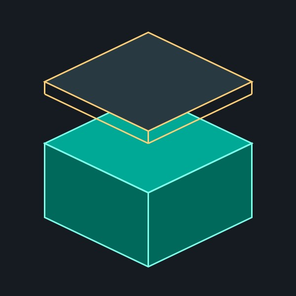

# Orca Box Studio

<p align="center"></p>

Estúdio paramétrico offline para **OrcaSlicer 2.5.1+**. Crie caixas e gabinetes com tampa por pressão, dobradiça reforçada, tampa deslizante ou parafusos nos quatro cantos. Interface em português/inglês, temas claro/escuro, aba principal em três colunas e painel lateral.

## Recursos

- **Lip snap:** saia de localização, ressalto de retenção e canal de encaixe correspondentes, com folga ajustável por lado.
- **Rugged:** nervuras integradas, dobradiça com pino removível ou eixo cativo print-in-place e duas travas flexíveis removíveis. Retire as travas antes de abrir a tampa.
- **Sliding:** trilhos e tampa com perfil a 45°, abertura frontal, puxador e detente traseiro. A espessura útil da tampa deriva do trilho e da folga; os controles de espessura/saia são ocultados neste estilo.
- **Screw corner:** quatro colunas integradas à base e furos correspondentes na tampa, para M2/M2.5/M3.
- Torres de PCB posicionadas pelo editor 2D ou por coordenadas, com diâmetro e profundidade de inserto/piloto editáveis; divisórias nos eixos X/Y; portas USB-C, HDMI, DC e ventilação em fendas ou hexágonos.
- Canal perimetral e junta TPU exportável para tampas que levantam; 12 presets editáveis e biblioteca pessoal salva fora do projeto.
- Visualização WebGL2 da mesma geometria usada na exportação, animação de abertura, raio-X e corte axial. O cálculo do modelo roda em segundo plano; o tempo de regeneração depende das dimensões e dos acessórios.
- Exportação STL binário e 3MF multiobjeto, organização na mesa sem escala automática e envio à instância atual do OrcaSlicer.

## Instalação e uso

Use o arquivo `dist/orca_box_generator.py` ou o wheel em `dist/` em **Plugins → Instalar plugin local**. O ícone se materializa quando necessário. Habilite o plugin e a permissão de execução em segundo plano solicitada.

Para desenvolver ou reconstruir, na raiz deste repositório:

```console
python -B scripts/build_and_install.py --no-install
python -B -W error -m unittest discover -s tests -v
```

Requer Python 3.12+ e NumPy 1.26+. No OrcaSlicer, use o Python embutido, que pode fornecer o NumPy na pasta de pacotes da aplicação. O instalador só copia para a instalação local quando executado **sem** `--no-install`.

Abra **Gerador de Caixas** na aba superior ou **Orca Box Studio — Painel Lateral** em Executar Plugins. Escolha um preset, ajuste as dimensões, confira os acessórios e gere o kit de calibração antes da peça final. Os botões STL/3MF salvam na pasta de exportação privada do plugin; **Abrir pasta de exportação** localiza os arquivos.

## Geometria, tolerâncias e impressão

O motor une paredes, colunas, divisórias, nervuras e acessórios **antes** de extrair a superfície. As aberturas são definidas por campos geométricos analíticos; a malha final aproxima as curvas com tetraedros conformes e raízes de arestas refinadas. Não usa sobreposição de sólidos como substituto de união.

A grade se refina nas interfaces curvas e nos eventos de altura. O alvo de erro de tesselação é inferior a `min(folga/4, 0,04 mm)` nas interfaces; a interface mostra o alvo em milímetros. Isso não representa a precisão da impressora. Testes verificam topologia, orientação, conectividade, perfis de encaixe e amostras dimensionais. Combinações incompatíveis geram uma explicação e precisam ser corrigidas antes da exportação.

Na montagem com pino, a base é exportada com o fundo para baixo e a tampa invertida. Em **print-in-place**, base e tampa são exportadas como um único objeto com duas cascas fechadas nas posições montadas; o organizador da mesa preserva essa relação. A tampa fica sobre uma grande cavidade: avalie pontes e suportes removíveis no fatiador e mantenha suporte fora das folgas da dobradiça. **Não há promessa de impressão sem suporte para print-in-place.**

Insertos M2/M2.5/M3 têm dimensões que variam entre fabricantes. Os valores iniciais são editáveis, e o kit replica o primeiro furo de torre configurado, ou usa M3 como referência. Paredes e fundo têm mínimo de 1,2 mm. A vedação TPU e a flexão das travas exigem testes físicos com o material escolhido; “caixa com junta” não significa impermeabilidade homologada. O kit é compacto; seu tempo real de impressão vem do fatiador.

## Compatibilidade e validação

O envio usa WM_COPYDATA no Windows, Cocoa no macOS e D-Bus de sessão no Linux. A confirmação significa **pedido de importação transmitido**, não confirmação de carregamento nem fatiamento. Se o envio falhar, os arquivos exportados continuam disponíveis.

As suítes automatizadas usam um host simulado e são executáveis nos três sistemas. A integração visual e o carregamento em uma instalação real de cada sistema ainda precisam de homologação; testes automatizados não substituem essa etapa. Não há publicação automática no OrcaCloud. Consulte o [registro de validação](docs/VALIDATION.md).

Veja [Manual PT-BR](docs/MANUAL_PT-BR.md), [English manual](docs/MANUAL_EN.md), [notas de implementação](docs/IMPLEMENTATION_NOTES.md) e [textos de divulgação](docs/COMMUNITY_LISTING.md). Licença [MIT](LICENSE), incluindo os avisos da infraestrutura adaptada de Orca Gear Studio.
