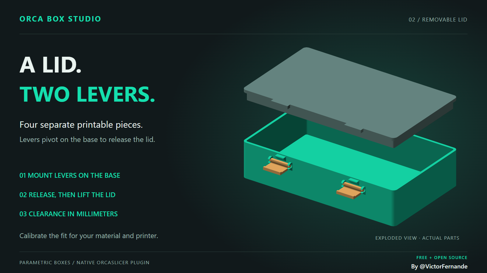
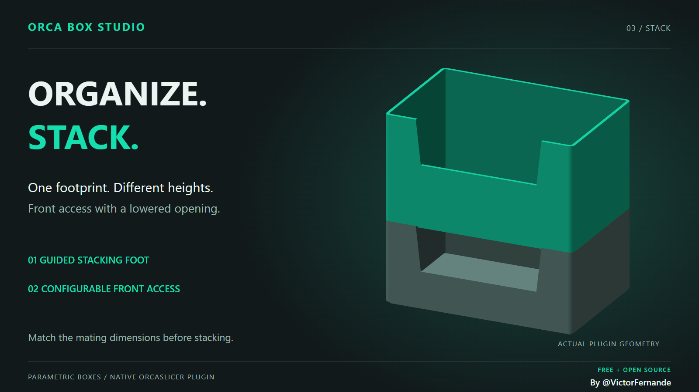
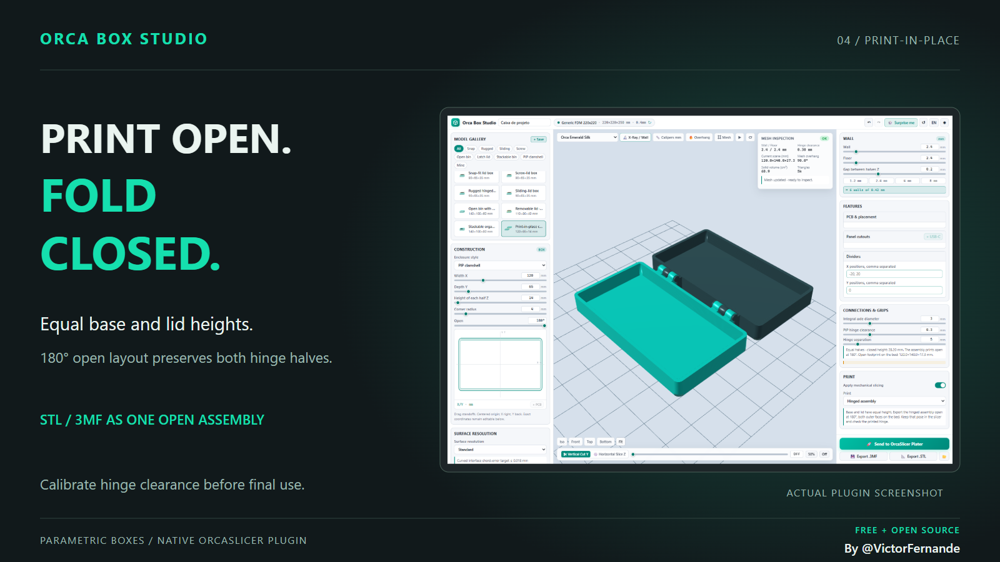
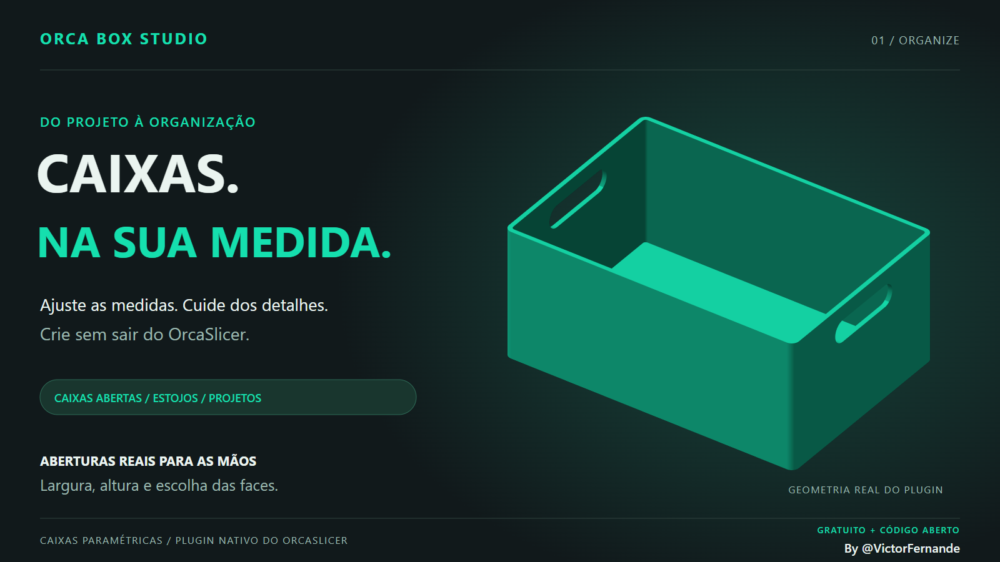
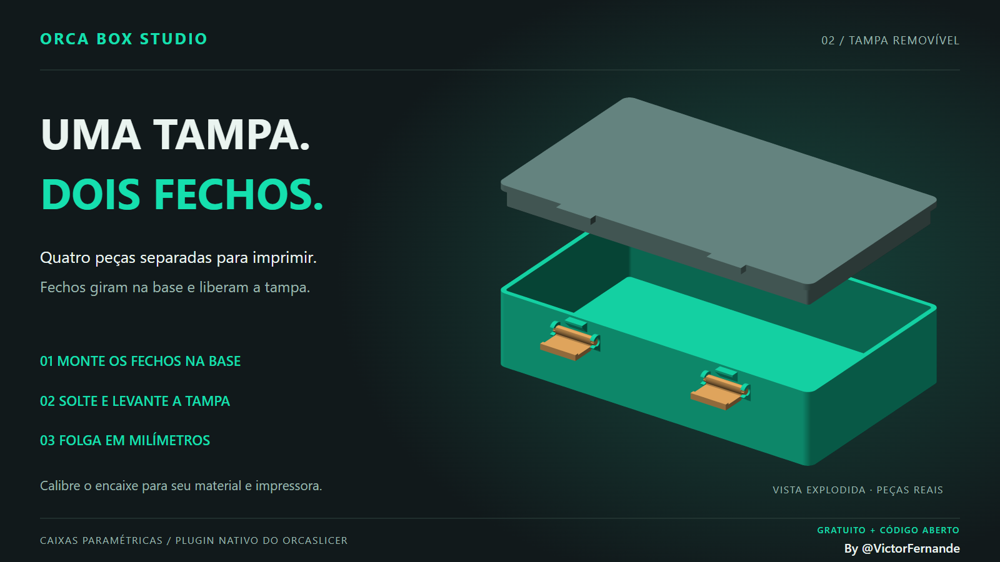
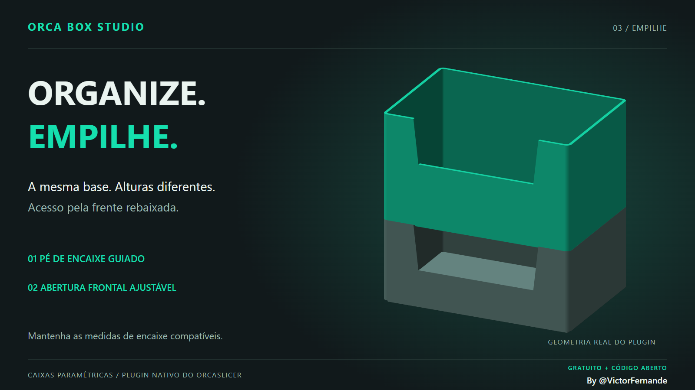
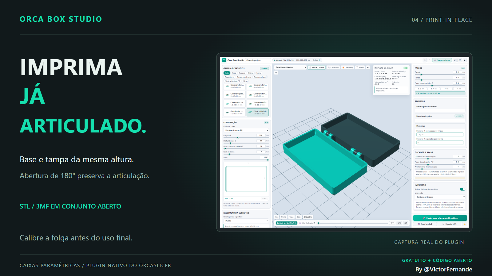

## English

**Boxes for your projects. Storage in your size.**

Design offline inside OrcaSlicer. Adjust width, depth, height and walls, start from 8 standard presets and save your own designs.

### Removable lid and two pivot levers

Print base, lid and two levers. Snap the levers into the base pivots, then rotate them to release the lid. Adjust skirt depth and hook engagement. Hinged Rugged, Lip Snap, Sliding Lid and Screw-Corner designs are also available.

### Stackable containers

Lowered front access and a guided stacking foot. Use matching mating dimensions to combine different heights. Open bins can also have configurable paired hand openings.

### Print-in-place, with equal halves

Make an articulated case with equal base/lid heights. Export it open at 180° as one assembly to preserve hinge placement. Inspect the real model and export STL / 3MF. Other styles support compatible PCB posts, dividers and ports.

Install and activate in **OrcaSlicer 2.5.1+**, then restart. PT/EN, light/dark, tab and dock. Calibrate fit with your printer and material; printed strength, stacking load and sealing are not certified.

---

## Português

**Caixas para seus projetos. Organização na sua medida.**

Projete offline no OrcaSlicer. Ajuste largura, profundidade, altura e paredes, comece com oito modelos padrão editáveis e salve seus modelos.

### Tampa removível e fechos de alavanca

Imprima base, tampa e dois fechos. Encaixe os fechos nos pivôs da base e gire para liberar a tampa. Ajuste a saia e o engate dos ganchos. Também há Rugged com dobradiça, Lip Snap, tampa deslizante e cantos com parafusos.

### Containers empilháveis

Frente rebaixada e pé de encaixe guiado. Combine alturas diferentes mantendo as medidas de encaixe compatíveis. As caixas abertas também oferecem alças vazadas configuráveis.

### Print-in-place com metades iguais

Crie um estojo com base e tampa da mesma altura. Exporte aberto a 180° como um conjunto, preservando a articulação. Inspecione a malha e exporte STL / 3MF. Outros estilos aceitam torres de PCB, divisórias e recortes compatíveis.

Instale e ative no **OrcaSlicer 2.5.1+** e reinicie. PT/EN, temas claro/escuro, aba e painel. Calibre o encaixe para sua impressora e material; resistência, carga de empilhamento e vedação não são certificadas.

---

**By @VictorFernande · Free / Gratuito · MIT**

[GitHub & Docs](https://github.com/victorFernande/orca-box-generator) · [Downloads](https://github.com/victorFernande/orca-box-generator/releases)
