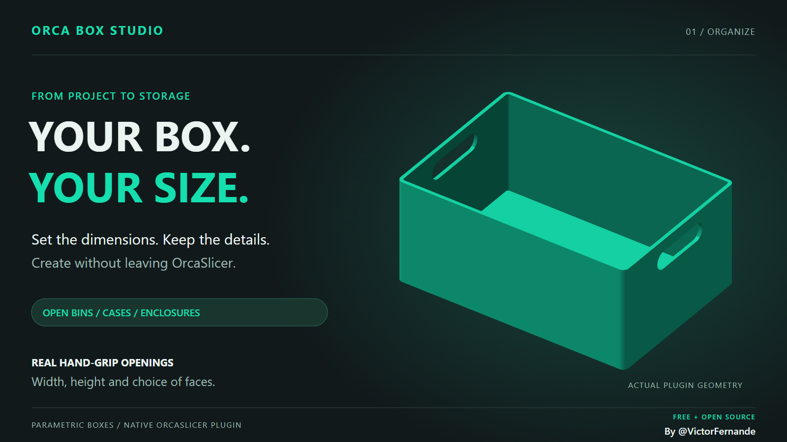

## English

**Boxes for your projects. Storage in your size.**

Design offline inside OrcaSlicer. Adjust width, depth, height and walls, start with eight presets and save variations.

### Removable lid and two pivot levers

In Removable Lid, print base, lid and two pivot levers. The levers stay on the base pivots and rotate to release the lid. Lip Snap, Sliding Lid and Screw-Corner designs are also available.

### Stackable containers

Lowered front access and a guided stacking foot. Use matching mating dimensions to combine different heights. Open bins can also have configurable paired hand openings.

### Rugged SnapLock and workspace

Start with 160 × 95 mm, a 35 mm base and a 20 mm lid. A rear snap hinge and two lid-mounted latches, printed separately. Resize and export STL / 3MF. A separate style offers an equal-half print-in-place case, open at 180°. PCB posts, dividers and ports depend on the style.

Install and activate in **OrcaSlicer 2.5.1+**, then restart. PT/EN, light/dark, tab and dock. Calibrate fit with your printer and material; printed strength, stacking load and sealing are not certified.

---

## Português

**Caixas para seus projetos. Organização na sua medida.**

Projete offline no OrcaSlicer. Ajuste largura, profundidade, altura e paredes, comece com oito modelos padrão e salve variações.

### Tampa removível e fechos de alavanca

No estilo Tampa com travas, imprima base, tampa e dois fechos de alavanca. Os fechos ficam nos pivôs da base e giram para liberar a tampa. Também há Lip Snap, tampa deslizante e cantos com parafusos.

### Containers empilháveis

Frente rebaixada e pé de encaixe guiado. Combine alturas diferentes mantendo as medidas de encaixe compatíveis. As caixas abertas também oferecem alças vazadas configuráveis.

### Rugged SnapLock e área de trabalho

Comece com 160 × 95 mm, base de 35 mm e tampa de 20 mm. Dobradiça traseira de encaixe e duas travas presas à tampa, impressas separadamente. Ajuste as dimensões e exporte STL / 3MF. Outro estilo oferece estojo print-in-place com metades iguais, aberto a 180°. Recursos de PCB, divisórias e recortes dependem do estilo.

Instale e ative no **OrcaSlicer 2.5.1+** e reinicie. PT/EN, temas claro/escuro, aba e painel. Calibre o encaixe para sua impressora e material; resistência, carga de empilhamento e vedação não são certificadas.

---

**By @VictorFernande · Free / Gratuito · MIT**

[GitHub & Docs](https://github.com/victorFernande/orca-box-generator) · [Downloads](https://github.com/victorFernande/orca-box-generator/releases)
