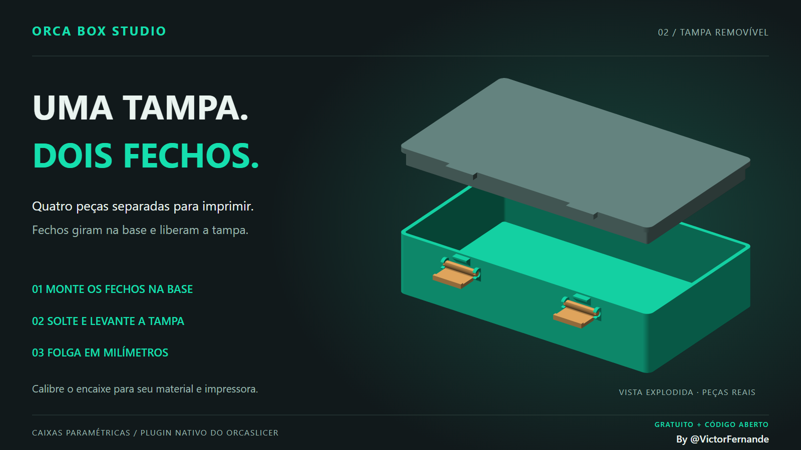
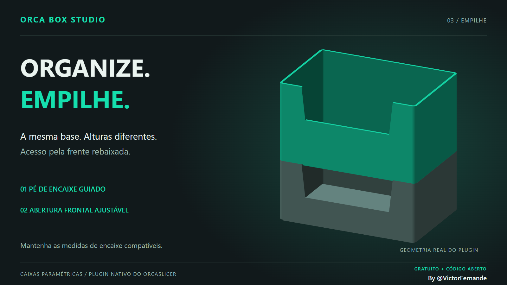
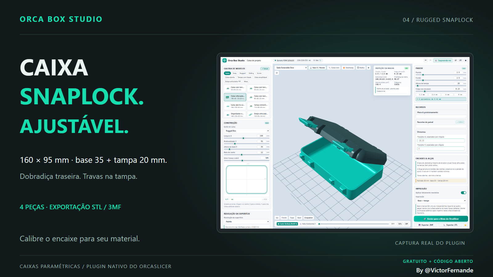

**Caixas para seus projetos. Organização na sua medida.**

Projete offline no OrcaSlicer. Ajuste largura, profundidade, altura e paredes, comece com oito modelos padrão e salve variações.

## Tampa removível e fechos de alavanca

No estilo Tampa com travas, imprima base, tampa e dois fechos de alavanca. Os fechos ficam nos pivôs da base e giram para liberar a tampa. Também há Lip Snap, tampa deslizante e cantos com parafusos.

## Containers empilháveis

Frente rebaixada e pé de encaixe guiado. Combine alturas diferentes mantendo as medidas de encaixe compatíveis. As caixas abertas também oferecem alças vazadas configuráveis.

## Rugged SnapLock e área de trabalho

Comece com 160 × 95 mm, base de 35 mm e tampa de 20 mm. Dobradiça traseira de encaixe e duas travas presas à tampa, impressas separadamente. Ajuste as dimensões e exporte STL / 3MF. Outro estilo oferece estojo print-in-place com metades iguais, aberto a 180°. Recursos de PCB, divisórias e recortes dependem do estilo.

Instale e ative no **OrcaSlicer 2.5.1+** e reinicie. PT/EN, temas claro/escuro, aba e painel. Calibre o encaixe para sua impressora e material; resistência, carga de empilhamento e vedação não são certificadas.
